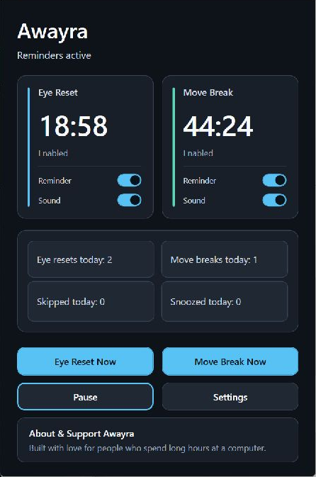
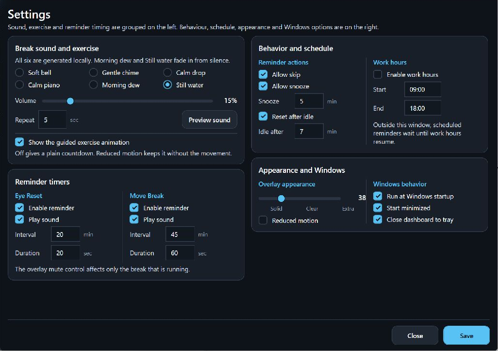
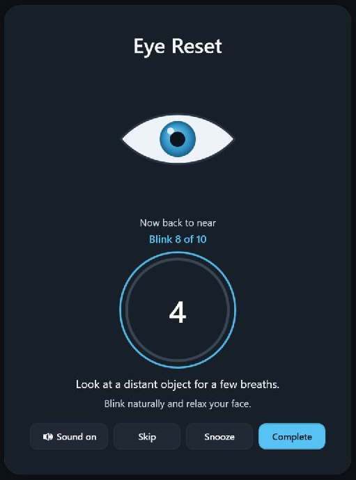
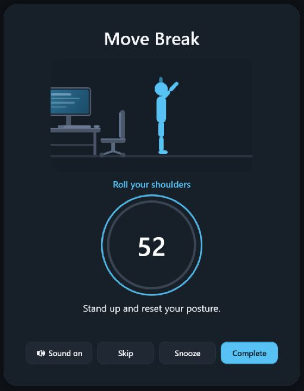
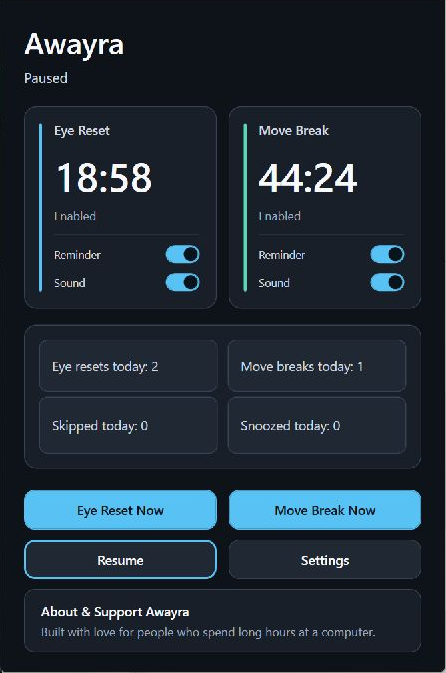
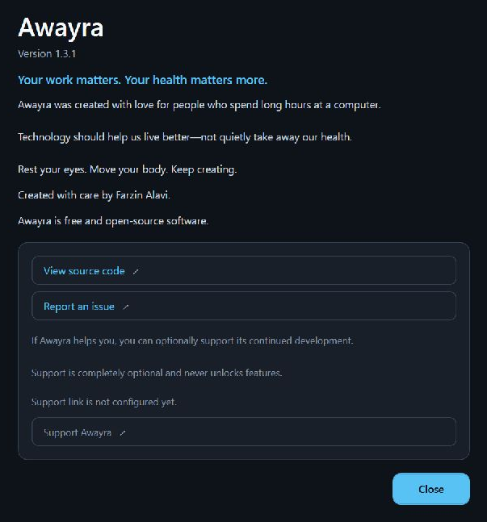

<div align="center">

# Awayra

## Look away. Move. Get back to work.

Free, open-source Windows reminders for eye rests and movement breaks, each on its own adjustable schedule.
Optional sounds, working hours, idle reset, snooze and skip. Works offline, without an account or telemetry.


### [Download Awayra for Windows](https://github.com/AWAYRA/AWAYRA-WPF/releases/latest/download/Awayra-Setup-x64.exe)

[Release notes](https://github.com/AWAYRA/AWAYRA-WPF/releases/latest) · [Report a bug](https://github.com/AWAYRA/AWAYRA-WPF/issues)

</div>

---

## See Awayra in action

### Two timers, one dashboard

See the next eye rest and movement break side by side. Enable reminders and sound separately for each type, start a break now, or pause reminders.

<p align="center">
  
</p>

### Set it up for your workday

Adjust each break's interval and duration, choose from six local sounds, and set volume and repeat timing. Configure work hours, idle reset, snooze, skip, overlay clarity and guided animations in one window.



### Guided eye rests and movement breaks

Eye Reset prompts you to look into the distance and blink. Move Break guides you to step away and move. Both include a countdown and controls to mute, skip, snooze or complete the current break.

<table>
  <tr>
    <th>Eye Reset</th>
    <th>Move Break</th>
  </tr>
  <tr>
    <td></td>
    <td></td>
  </tr>
</table>

These are actual Awayra 1.3.1 captures with the default break intervals and durations. Sound, idle and Windows preferences show an example configuration. The default eye rest is 20 seconds every 20 minutes; the default movement break is 60 seconds every 45 minutes. Both schedules are adjustable. Sound is optional and repeats during a break; there is no separate end-only chime.

### Every settings group, up close

**Sound & guided exercise** — Choose from six local sounds, adjust volume and repeat timing, preview a sound, and switch guided animation on or off.


**Independent timers** — Set reminder, sound, interval and duration separately for Eye Reset and Move Break.


**Work hours, snooze & idle** — Choose skip and snooze permissions, a snooze duration, an idle threshold and your work hours.


**Appearance & Windows** — Adjust overlay clarity and reduced motion. Choose startup, minimized launch and close-to-tray behavior.


### Pause, version and support

<table><tr><th>Pause & resume</th><th>About & support</th></tr><tr><td></td><td></td></tr></table>

Financial support is optional. The application currently shows that its payment link is not configured.

---

# Why Awayra?

Most of us do not intentionally decide to sit in front of a screen for hours without moving.

It simply happens.

You start working.

You answer one more email.

You fix one more bug.

You finish one more task.

And suddenly hours have passed.

Your eyes have been staring at the same distance.

Your shoulders have barely moved.

You have been sitting in the same position far longer than you realized.

**Awayra exists to interrupt that pattern.**

Not by distracting you constantly.

Not by tracking you.

Not by sending your data somewhere.

Just by giving you a small reminder at the right moment:

> 👀 Look away.  
> 👁️ Blink.  
> 🧍 Stand up.  
> 🚶 Move.  
> 🧘 Stretch.  
> ❤️ Take care of yourself.

A few seconds away from the screen can be easy to forget.

Awayra helps you remember.

---

# ❤️ Health comes before productivity

Productivity matters.

Deadlines matter.

Your work matters.

But none of them should require ignoring your body for hours at a time.

A successful career, a growing company, money, technology and achievements have far less value when your health is constantly being neglected.

Awayra was created around a simple principle:

## **Your computer should help remind you to take care of the person using it.**

We cannot promise that a reminder app will prevent medical problems.

What Awayra can do is help you build a healthier routine around screen use by making regular eye breaks and movement harder to forget.

---

# 👀 Take care of your eyes

Long periods of concentrated screen use can make it easy to forget to blink regularly or look into the distance.

Awayra includes a dedicated **Eye Reset** reminder inspired by the commonly recommended **20-20-20 habit**.

By default, every 20 minutes Awayra gives you a short 20-second break.

During the break, a guided animation encourages you to:

- look away from the screen
- shift your focus into the distance
- relax your eyes
- blink naturally
- briefly disconnect from close-up screen focus

The default guided exercise includes **10 counted blinks over 20 seconds**.

It is deliberately simple.

The goal is not another complicated wellness routine.

The goal is to make taking a short eye break something you actually remember to do.

---

# 🧍 Your body needs breaks too

Humans were not designed to remain almost motionless in front of a monitor all day.

Awayra's **Move Break** reminds you to periodically leave your working position and move.

The guided routine can encourage you to:

- stand up
- walk for a moment
- stretch your arms
- move your shoulders
- stretch your upper body
- perform simple squats
- briefly get away from your desk

The goal is not exercise performance.

The goal is simple:

## **Do not let hours of sitting pass without noticing.**

---

# ✨ Designed to help, not annoy

A break reminder is useless if you disable it after two days.

Awayra is designed to remain calm and unobtrusive during normal work.

When it is time for a break, it provides a clear fullscreen reminder with simple controls.

You remain in control.

You can:

- complete the break
- pause it
- snooze it
- skip it
- mute individual reminders
- change schedules
- change durations
- disable guided animations
- enable Reduced Motion

Awayra encourages healthier habits without trying to control how you work.

---

# 🎯 Two independent reminder systems

Awayra includes two separate schedules.

| Reminder | Default interval | Default duration |
|---|---:|---:|
| 👀 Eye Reset | 20 minutes | 20 seconds |
| 🧍 Move Break | 45 minutes | 60 seconds |

Every interval and duration can be customized.

You can adapt Awayra to your own work style instead of adapting your work to the application.

---

# 🌿 Guided break experiences

A break should feel like a break.

Awayra does more than display a number counting down.

### 👁️ Eye Reset

A calm visual exercise guides your focus while ten complete blinks are counted on screen.

### 🚶 Move Break

A guided character demonstrates a short sequence of standing, walking and stretching movements.

If you prefer something simpler, guided animations can be disabled completely.

Awayra also includes **Reduced Motion** mode for users who prefer static guidance instead of animated movement.

---

# 🔔 Calm sounds, not alarms

A health reminder should not scare you.

Awayra includes six locally generated reminder sounds.

Nothing is downloaded from the internet.

| Sound | Style |
|---|---|
| Soft bell | Short gentle alert |
| Gentle chime | Light notification |
| Calm drop | Soft minimal tone |
| Calm piano | Four-note piano phrase |
| Morning dew | Gentle rising five-note melody |
| Still water | Slower, deeper calming melody |

The softer melodies fade in gradually instead of suddenly starting at full volume.

Volume and repeat behavior are fully configurable.

---

# 🖥️ Built for real Windows workflows

Awayra supports the situations that happen during normal computer use:

- Windows 10 and Windows 11
- multiple monitors
- per-monitor DPI
- monitor sleep and wake
- lock and unlock
- suspend and resume
- display configuration changes
- Windows startup
- start minimized
- system tray operation
- idle detection
- optional working-hour restrictions
- daily break statistics

It is designed to stay out of your way until you actually need it.

---

# 🔒 Your privacy stays on your computer

This matters to us.

## Awayra does not need your personal data.

There is:

- ❌ no account
- ❌ no advertising
- ❌ no telemetry
- ❌ no analytics tracking
- ❌ no cloud account
- ❌ no browsing-history collection
- ❌ no application-usage tracking
- ❌ no screenshot uploading

Awayra works offline.

Your settings, statistics and logs stay locally under:

`%LocalAppData%\Awayra\`

### What about the blurred background?

When a break begins, Awayra can temporarily capture the display under the break overlay and blur it to create a frosted-glass effect.

That image:

- exists only in memory
- is never written to disk
- is never uploaded
- never leaves your computer
- is discarded when the break closes

If you do not want the screen captured at all, change:

**Overlay appearance → Solid**

---

# 💚 Free and open source

Awayra is free.

No subscription.

No premium health features hidden behind a payment screen.

No account required.

The source code is available publicly so developers can inspect how the application works.

Awayra is licensed under **GPL-3.0-only**.

---

# ⬇️ Download

| File | Purpose |
|---|---|
| [**Awayra-Setup-x64.exe**](https://github.com/AWAYRA/AWAYRA-WPF/releases/latest/download/Awayra-Setup-x64.exe) | Latest Windows x64 installer |
| [Awayra-Setup-x64.sha256.txt](https://github.com/AWAYRA/AWAYRA-WPF/releases/latest/download/Awayra-Setup-x64.sha256.txt) | SHA-256 verification |
| [GitHub Releases](https://github.com/AWAYRA/AWAYRA-WPF/releases) | Previous versions and release notes |

The installer already includes the required .NET runtime.

Official Awayra executables are distributed only through this repository's GitHub Releases.

Unsigned builds may trigger a Windows SmartScreen warning. You can verify the published SHA-256 checksum before installation.

---

# Installation

Awayra installs per-user under:

`%LocalAppData%\Programs\Awayra`

Administrator access is not required.

When upgrading, Awayra preserves your settings, reminder schedules and statistics by default.

You can explicitly choose to remove existing data during installation or uninstallation.

Silent clean installation:

```bash
Awayra-Setup-x64.exe /VERYSILENT /CLEANDATA=yes
```

Silent uninstall with data removal:

```bash
unins000.exe /VERYSILENT /CLEANDATA=yes
```

---

# For developers

### Requirements

- Windows 10 or Windows 11 x64
- .NET 10 SDK
- PowerShell
- Inno Setup 7

### Run locally

```powershell
powershell -ExecutionPolicy Bypass -File .\scripts\dev.ps1
```

### Build and test

```powershell
powershell -ExecutionPolicy Bypass -File .\scripts\verify-change.ps1
```

### Build installer

```powershell
powershell -ExecutionPolicy Bypass -File .\scripts\build-installer.ps1
```

---

# Repository structure

| Project | Responsibility |
|---|---|
| `src/Awayra.Core` | Scheduling, settings, validation, statistics and domain logic |
| `src/Awayra.App` | WPF UI, tray integration, overlays, persistence, sounds, diagnostics and Windows integration |
| `tests/Awayra.Core.Tests` | Platform-neutral domain tests |
| `tests/Awayra.App.Tests` | WPF application and service tests |
| `tests/Awayra.UiTests` | Windows UI automation tests |

---

# Contributing and security

Read [CONTRIBUTING.md](CONTRIBUTING.md) before contributing.

Security reports should follow [SECURITY.md](SECURITY.md).

Release history is available in [CHANGELOG.md](CHANGELOG.md).

Use of the Awayra name and logo is covered by [TRADEMARKS.md](TRADEMARKS.md).

---

<div align="center">

# ❤️ Your health matters.

Software should not only help us work more.

Sometimes it should remind us when it is time to stop working for a moment.

**Look away. Move. Stretch. Blink. Breathe.**

Then continue.

### Made with ❤️ for healthier screen habits around the world.

Copyright © 2026 Farzin Alavi.

Awayra is licensed under **GPL-3.0-only**.

</div>

> **Medical notice:** Awayra is a wellness and break-reminder application, not a medical device and not a substitute for professional medical advice. Persistent eye pain, severe headaches, double vision, numbness or ongoing musculoskeletal pain should be evaluated by a qualified healthcare professional.
